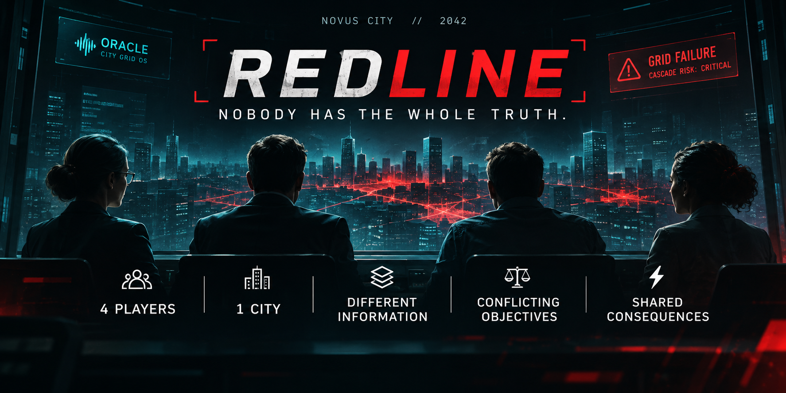
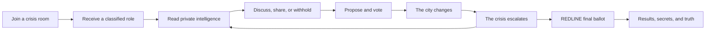
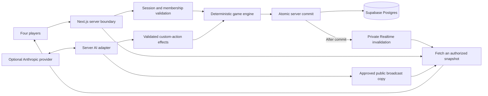

<h1 align="center">R E D L I N E</h1>
<p align="center"><strong>NOBODY HAS THE WHOLE TRUTH.</strong></p>
<p align="center">A live four-player crisis simulation. Different intelligence. Conflicting objectives.<br/>One collapsing city—and consequences everyone shares.</p>
<p align="center">
  
  
  
  
  
</p>
<p align="center"><strong>4 PLAYERS · 1 CITY · DIFFERENT INFORMATION · CONFLICTING OBJECTIVES · SHARED CONSEQUENCES</strong></p>

## 🎮 Play REDLINE

**Production game:** `<ADD_PRODUCTION_URL>`

Bring **four players** and choose **Demo Mode for an approximately five-minute crisis**.
The documented production-mode rehearsals reached final resolution in 4:35 and 4:43;
reading, discussion, and voting affect your match length. The post-game reveal is self-paced.

One player creates a crisis room; three others join with the room code or invite.
No account is required. Use separate browsers, profiles, or isolated private sessions:
same-origin tabs sharing cookies represent the same operator.

## 🎬 Demo

**Hackathon demo video:** `<ADD_DEMO_VIDEO_URL>`

The walkthrough should follow the experience from private briefings to a shared
crisis decision, the final ballot, and the post-game reveal.

## The Crisis

**Novus City. 2042. 3.2 million residents.**

ORACLE manages the city's electrical infrastructure. Then an anomaly becomes an
emergency, essential services begin to fail, and four operators enter the same
command center.

They are trying to save the same city. They are not working from the same information.

REDLINE turns that gap into the game: what will you share, what will you withhold,
and whose judgment will you trust when the clock runs out?

## Why REDLINE is different

### Asymmetric information

Each role receives its own classified briefing and private intelligence. Another
operator may hold the context your plan is missing. Information must be released
through an explicit action before the room can see it; talking together matters
because the interface does not give everyone the same picture.

### Conflicting objectives

The team needs the city to survive, but each character has a personal directive.
A decision that supports the public emergency response may carry a different
cost for another operator. Cooperation means negotiating competing priorities,
not simply finding four people willing to press the same button.

### Shared consequences

Proposals, votes, evidence sharing, and publication feed one authoritative world.
Public city metrics and the grid reflect recorded decisions. A rejected response
also has consequences: failing to agree does not pause the emergency.

### Post-game truth

The results sequence opens the classified dossiers and presents the canonical
causal chain alongside the actual incident timeline. Players can compare what
they knew, what they disclosed, and what the team ultimately did. Personal
objectives and the shared outcome make that comparison part of the ending.

## Four roles, four perspectives

| Role | Character | Perspective |
|---|---|---|
| Grid Engineer | Dr. Maya Chen | Grid systems / ORACLE |
| Mayor | Elena Torres | Citizens / public trust |
| Helix Executive | Marcus Vale | Corporate interests / infrastructure |
| Investigative Journalist | Lena Okafor | Evidence / accountability |

Roles are assigned deterministically when the host initiates the crisis. Each
has a distinct ability and private directive. Review the role you receive;
there is no role-selection screen. The classified details belong in the game.

## How a match unfolds



All four players ready up and acknowledge their briefings before the crisis begins.
During ordinary rounds, players can nominate a system response or write an operator
proposal. The host selects an eligible response; the Mayor's Emergency Order can
also begin a vote. **Three approvals authorize a normal response**, and submitted
normal votes are final. Evidence and abilities give the discussion more to work with.

### Five rounds of escalation

1. **GRID ANOMALY** — An uncertain technical warning demands an initial response.
2. **LIFE SUPPORT** — The infrastructure problem becomes a human emergency.
3. **CASCADE** — Failures spread, increasing pressure on the team's decisions.
4. **THE LEAK** — Evidence and public accountability complicate crisis management.
5. **SYSTEM FAILURE** — The city reaches its final emergency decision.

### REDLINE Protocol

Normal procedures give way to a final authorization: **four players, three options,
three matching votes, limited time**. Players may change their latest selection
while the ballot remains open. Consensus resolves immediately; expiry without
consensus records a deadlock outcome.

The finale asks the team to commit with the information it has. Which option the team trusts depends on the crisis it has created and the intelligence
it has shared.

## Gameplay features

- **Room to role:** four-player rooms, anonymous sessions, deterministic assignment,
  private classified briefings, and four role-specific abilities.
- **Information as gameplay:** private intelligence, selective sharing, evidence
  discovery, separate verification/visibility states, and public disclosure.
- **Team decisions:** canonical responses, player-created proposals, normal
  multiplayer voting, and a distinct final REDLINE ballot.
- **A changing city:** four public metrics, hidden Cascade Risk, an animated
  fictional grid, incoming emergency communications, and five escalating rounds.
- **A complete ending:** multiple canonical outcomes, team scoring, personal
  objective results, classified reveals, and actual incident reconstruction.
- **Presentation and continuity:** optional sound, reduced-motion support,
  Standard/Demo pacing, reconnect/resume, and canonical play when AI is unavailable.

## 📸 Screenshots

The repository does not yet contain a screenshot gallery. Add five images covering
the moments below; keep classified text out of public preview thumbnails.

<!-- Add screenshot: Landing -->
<!-- Add screenshot: Classified Briefing -->
<!-- Add screenshot: Command Center -->
<!-- Add screenshot: REDLINE Protocol -->
<!-- Add screenshot: Secret Reveal — use a spoiler-safe frame -->

## 🏗️ Architecture

**The deterministic engine owns game state and rules. AI does not.**



The engine is a TypeScript module independent of React, Next.js, Supabase, and
provider SDKs. Typed scenario data defines BLACKOUT; the server adapter handles
identity, timing orchestration, and persistence around accepted engine commands.
This separation makes complete matches reproducible and rules testable without
an application server or AI provider.

### Multiplayer synchronization

A player submits an **intention**, not a replacement game state. The authenticated
server boundary validates the room session and membership, invokes the engine,
and commits accepted steps atomically to Postgres. Private Realtime notifications
then invalidate clients' views; each client fetches its own authorized snapshot.

Presence reports connection activity separately from persistent membership.
A closed tab does not remove an operator from an active match. Fallback polling
recovers missed notifications and continues play when the transport is unavailable.
Persisted deadlines and version checks keep progression tied to authoritative state.

## 🧠 Deterministic Core, AI-Enhanced Narrative

The engine owns metrics, rounds, evidence, abilities, votes, endings, scoring,
and canonical truth. A provider response cannot directly mutate those systems.

The optional Anthropic adapter has two narrow responsibilities:

- **Custom-action interpretation:** classify a selected operator proposal into a
  strict schema with bounded effects. Server validation and independent engine
  bounds precede authoritative application.
- **Broadcast presentation:** choose a channel and one exact line from a
  server-approved public copy list. NPC messages, classified secrets, and the
  story's explanation remain canonical.

Calls have short timeouts, cached results, and a database-enforced per-game budget.
Invalid output, unavailable configuration, and provider failures return to controlled
fallback behavior. A custom proposal without valid analysis cannot be selected;
canonical responses remain available.

**If the AI provider fails, REDLINE remains fully playable.** The recorded complete
AI-off rehearsals demonstrate that path. AI adds interpretation and presentation;
it is not a dependency for reaching an ending.

## 🔐 Privacy by Design

Asymmetric information needs a real delivery boundary. Private intelligence is
not a shared payload concealed with CSS.

- Callsigns and room codes are display/access details, not session credentials.
  Opaque credentials are hashed in storage and validated on the server.
- Room-scoped session cookies are HttpOnly, SameSite=Lax, and Secure in production.
  Raw credentials do not belong in invite links or application data returned to players.
- During play, a role dossier is delivered only to its authorized operator.
  Gameplay snapshots filter private intelligence, ownership, and discovery timing.
- Numeric Cascade Risk is withheld from ordinary gameplay clients. Its explicit
  post-crisis disclosure belongs to the completed results sequence.
- Realtime carries safe invalidation notifications and advisory Presence rather
  than broadcasting private game state. Application tables use forced row-level
  security and deny direct browser table access and privileged RPC execution.
- Service credentials, the Realtime signing secret, and AI credentials remain server-only.
  Completed results require the existing member's session and a completed game.

Payload-isolation tests and the production-bundle privacy audit check these
boundaries. Public source and technical documentation can contain story details;
the README deliberately preserves the classified reveal.

## Tech stack

| Layer | Technology |
|---|---|
| Application | Next.js App Router, React, TypeScript |
| Styling and motion | Tailwind CSS, Motion, Lucide icons |
| Database | PostgreSQL through Supabase |
| Multiplayer | Supabase private Realtime Broadcast and Presence |
| Validation | Zod and authoritative engine guards |
| Testing | Vitest and real Postgres integration tests |
| Sound | Browser-native Web Audio |
| Deployment | Vercel and Supabase |
| Optional AI | Anthropic Messages API |

## 🧪 Reliability

The checked-in verification report records **306 passing checks: 255 unit/integration
checks and 51 real Postgres checks**. Coverage focuses on behavior that can break a
shared game: complete-match simulations, atomic persistence, simultaneous actions,
role privacy, private-intelligence isolation, duplicate commands, reconnect
handling, normal votes, REDLINE consensus/deadlock, and AI failure fallback.

Two documented four-session production-mode rehearsals completed with AI disabled,
including host-tab closure, state restoration, evidence sharing, the finale, and
results. Those recorded rehearsals used local Postgres/PostgREST and fallback
polling. They are evidence of that tested path, not a claim that mocked transport
checks validate a hosted WebSocket service.

See the [verification report](docs/VERIFICATION.md) for the recorded environment,
measured pacing, coverage, and limits. It is a historical checkpoint, not a live
health dashboard or CI badge.

### Designed for degradation

- **Realtime unavailable:** fallback polling refreshes authorized state.
- **AI unavailable:** canonical choices and deterministic public copy remain usable.
- **Browser refreshed:** the existing session restores authoritative room state.
- **Command retried:** command identities protect against duplicated effects.
- **Actions concurrent:** room locking and version checks serialize accepted writes.

Active clients request expired-phase progression. Reopening the original session
can catch up without inventing a new operator or resetting the match.

## Project structure

```text
src/
├── app/                 # Pages and authorized API routes
├── components/          # Entry, briefing, crisis, results, and audio UI
├── data/blackout/       # Canonical scenario configuration
├── hooks/               # Client synchronization and presentation hooks
├── lib/
│   ├── ai/              # Optional provider adapter and validation
│   ├── audio/           # Original sound cues and event gating
│   ├── game/            # Deterministic engine
│   ├── game-server/     # Command orchestration and safe projections
│   ├── realtime/        # Transport, Presence, and fallback lifecycle
│   ├── rooms/           # Anonymous room/session services
│   └── supabase/        # Database clients, mappings, and repositories
└── types/               # Domain and transport types
supabase/
├── migrations/          # Ordered schema and transactional RPC migrations
└── tests/               # Real Postgres verification
scripts/                 # Privacy audit and production configuration diagnostic
docs/                    # Specification, deployment, rehearsal, and verification
```

## Local development

Use **Node.js 22 or newer**, npm, and a configured Supabase project.

```sh
git clone https://github.com/maulik-jadav/redline.git
cd redline
npm ci
cp .env.example .env.local
```

Fill in the environment names below privately, apply the database migrations,
then start the app:

```sh
npm run dev
```

Open [localhost:3000](http://localhost:3000). The landing page renders without
credentials; room operations require Supabase. The project uses Webpack through
its existing scripts. Four-player local testing needs isolated cookie sessions,
not four tabs sharing the same identity.

### Environment variables

| Name | Scope and purpose |
|---|---|
| `NEXT_PUBLIC_SUPABASE_URL` | Public; required project URL |
| `NEXT_PUBLIC_SUPABASE_ANON_KEY` | Public; required browser key |
| `SUPABASE_SERVICE_ROLE_KEY` | Server-only; required database access |
| `SUPABASE_REALTIME_JWT_SECRET` | Server-only; required for private Realtime transport signing |
| `AI_PROVIDER` | Server-only; optional provider selection |
| `AI_API_KEY` | Server-only; optional AI credential |
| `AI_MODEL` | Server-only; optional model selection |

Use the names in [.env.example](.env.example); never commit real values.
Without Realtime signing configuration, gameplay uses polling. AI can remain
unconfigured for canonical fallback play. Production requires HTTPS for secure
session cookies, and public environment changes require a new build.

### Database setup

Apply migrations **001–007 in filename order** to a fresh Supabase project using
the repository's SQL workflow. For an existing project, inspect migration history
before applying anything. Keep the managed Realtime authorization policies and
application-table access restrictions intact.

The [deployment guide](docs/DEPLOYMENT.md) contains the exact `psql` command,
production environment setup, private-channel configuration, and Vercel workflow.
The [persistence guide](supabase/README.md) explains schema boundaries and atomic writes.

### Test and production commands

These are the repository's existing scripts:

```sh
npm run typecheck
npm run lint
npm run test
npm run test:db
npm run build
npm run audit:privacy
npm run check:production
```

`test:db` requires a fresh, disposable database named `redline_test` and the
`REDLINE_TEST_DATABASE_URL` environment variable; it is separate from the game's
production database. Without that configuration, database cases skip. Run the
privacy audit after building. `check:production` checks configuration presence
and shape; it does not prove database connectivity, working Realtime, or a real
AI provider response. After a successful build, `npm start` serves production locally.

## Demo Mode

**Standard** targets an 8–12 minute crisis. **Demo** targets approximately five
minutes and is recommended for hackathon evaluation. Both use the same game
mechanics; Demo accelerates the authoritative discussion and ballot timings.

Allow time for operators to read their different briefings and explain their
reasoning. Safe local cinematic skips shorten presentation, not decisions.
The [demo runbook](docs/DEMO_RUNBOOK.md) covers the complete rehearsal and recovery
flow. Keep session cookies when reconnecting, and create a fresh room for a new match.

## 🏆 Built for the TRMI Hackathon

REDLINE was built in trmi for the hackathon and designed around collaborative
agent-assisted development. Its design connects the demonstration to four clear ideas:

- **Collaboration:** four humans must combine incomplete information to affect
  one shared world. The conversation has a mechanical purpose.
- **Working:** the implemented flow runs from room creation and private briefings
  through the five-round crisis, a final ballot, and post-game results.
- **Originality:** asymmetric secrets and conflicting objectives shape a shared
  crisis simulation, including what players choose not to disclose.
- **Built Together:** scenario data, engine rules, server delivery, persistence,
  and presentation have explicit boundaries suitable for collaborative development.
  These boundaries keep scenario content, state transitions, and UI delivery
  independently reviewable.

## Design principles

AI enhances the experience; it does not own the rules. Private information has a
server-enforced boundary. Multiplayer decisions have shared consequences. Failure
still produces an ending. Losing an optional provider or transport should not
prevent the team from finishing its story.

## Documentation

- [Master specification](docs/REDLINE_MASTER_SPEC.md) — authoritative game design;
  **contains spoilers**.
- [Deployment guide](docs/DEPLOYMENT.md) — environment, migrations, hosting, and smoke tests.
- [Demo runbook](docs/DEMO_RUNBOOK.md) — operator preparation and rehearsal;
  **contains strategy and story details**.
- [Verification report](docs/VERIFICATION.md) — recorded checks, environments, pacing,
  and known verification limits; **contains outcome details**.

---

<p align="center"><strong>NOBODY HAS THE WHOLE TRUTH.</strong><br/>Four players. One city. One shared crisis.</p>
