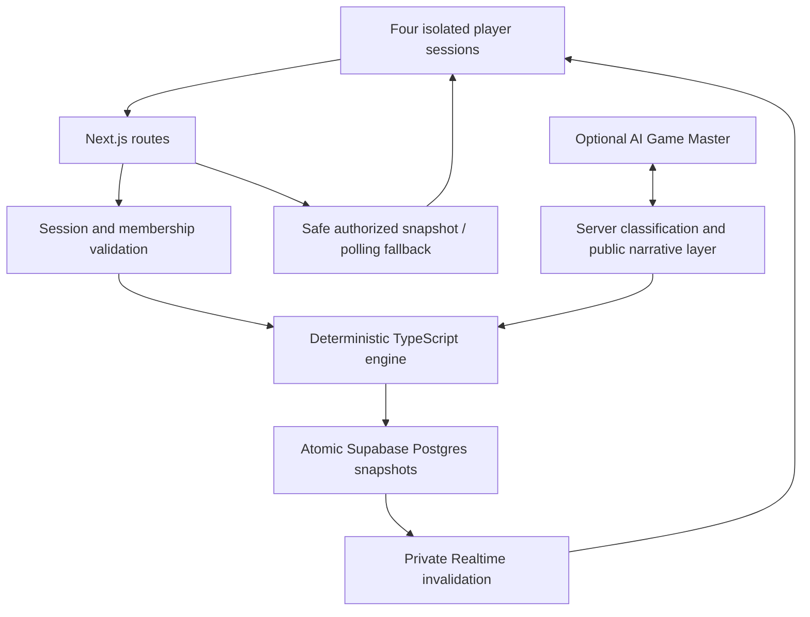

# REDLINE

**Nobody has the whole truth.** Four operators manage a failing city with private
intelligence, conflicting objectives, and shared decisions. BLACKOUT unfolds
across five rounds, ending in a timed REDLINE protocol and a reconstruction of
what actually happened.

Multiplayer is the premise: one operator knows the technical warning, another
holds the maintenance report, another must protect civilians, and another can
publish the evidence. Players decide what to reveal and whom to believe.

## Competition build

The complete game has cinematic briefings, a live fictional grid, private/shared
evidence, four role abilities, proposals and voting, all six canonical endings,
and a controlled results/secret/truth sequence. Sound is optional and off by
default: SOUND ON unlocks short original browser-generated cues after interaction.
No audio files, external media, account system, or heavy rendering library is required.

Gameplay is frozen. Milestone 11 adds presentation, sound, hardening, diagnostics
and deployment preparation. Hosted access is still required to verify deployment
and live Supabase Realtime; local polling verification is not a substitute.

## Core loop

Create a room in Standard or Demo mode; three operators join with callsigns.
Ready all four, initiate as host, and privately review/acknowledge assigned roles.
Share intelligence, discover evidence, nominate a canonical response or write a
custom proposal, and authorize it with three approvals. The Mayor can open a vote
with Emergency Order. Ordinary submitted votes are final. Round 5 offers three
REDLINE options; latest selections may change until three match or time expires.

Standard uses canonical 60/10/20-second discussion/selection/vote timings and a
30-second REDLINE ballot. Demo uses 25/5/10 and 15 seconds. Local cinematic skips
never bypass authoritative deadlines. Results reveal persisted scores/directives,
actual awards if supplied, four canonical secrets, truth and actual history.

## Architecture



The engine owns all state transitions, evidence, ability rules, votes, metrics,
endings, objectives and scoring. It has no React, Next.js, Supabase or AI dependency.
Commands carry identity/version information; server transactions validate the
session, lock the room and persist accepted engine steps atomically. Deadlines
persist once per phase. Active clients request expiry; reconnect catches up.
There is no scheduler, client-authoritative timer, or host migration mechanic.

AI classifies selected custom proposals into a strict category/effect schema;
public deltas are bounded to ±15 and the hidden delta to ±20, with independent
engine validation. Optional narrative selects an exact approved public line and
channel. It cannot invent facts, change evidence or own game state. Canonical
copy and choices work without AI. Calls time out after 1.5 seconds and are cached
under a database-enforced ten-request budget including failures. Unavailable
custom analysis leaves canonical responses available. Secrets/truth are never AI-written.

## Privacy model

Anonymous identity uses room-scoped HttpOnly, SameSite=Lax cookies, Secure in
production. Only hashes are stored; invite links contain no credentials. Four
same-origin tabs share one identity—use separate browsers/profiles/private sessions.

Every application table uses forced RLS with service-only access. Browser table
writes and privileged RPC calls are denied. Server routes validate membership,
then explicitly project public state and only the requesting operator's private
intel/evidence. Future material, dossiers and numeric Cascade Risk stay out of
gameplay payloads and static bundles. Completed results have a separate gate.

Realtime uses a five-minute server-issued transport JWT and private room channel.
It carries safe invalidation, not private rows; Presence is advisory. Network
failures preserve mutations and activate polling. See [persistence/security setup](supabase/README.md).

## Stack and local setup

Next.js App Router, React, strict TypeScript, Tailwind CSS, Motion, Lucide, Zod,
Supabase JS, Vitest and PostgreSQL. Use Node 22+ and npm.

```sh
npm ci
cp .env.example .env.local
# Configure the values below privately and apply the seven migrations.
npm run dev
```

The landing page works without credentials; room creation requires Supabase.
Factories are lazy and missing configuration returns a safe unavailable state.
Webpack is the supported build mode here. Fonts use local system stacks.

Required: `NEXT_PUBLIC_SUPABASE_URL`, `NEXT_PUBLIC_SUPABASE_ANON_KEY`,
`SUPABASE_SERVICE_ROLE_KEY`. Optional AI: `AI_PROVIDER=anthropic`, `AI_API_KEY`,
`AI_MODEL` (defaults to `claude-haiku-4-5`). Hosted private Realtime requires
`SUPABASE_REALTIME_JWT_SECRET` matching the project's HS256 verifier; without it,
local gameplay uses polling. Only the two NEXT_PUBLIC values are browser-safe.

Apply migrations 001–007 in order to a fresh Supabase project; no new migration
is needed for polish. Exact commands, production environment configuration,
Vercel deployment and hosted verification are in [DEPLOYMENT](docs/DEPLOYMENT.md).

## Validation

```sh
npm run typecheck
npm run lint
npm run test
npm run build
npm run audit:privacy
npm start
```

Real database tests require an empty disposable database named `redline_test`:

```sh
REDLINE_TEST_DATABASE_URL='postgresql:///redline_test' npm run test:db
```

The suite applies all migrations, uses a managed-Realtime table fixture for local
RLS tests, and verifies persistence, sessions, concurrency, full matches, privacy,
AI fallback and transport recovery. The fixture is not a live Realtime service.
The production bundle audit checks canonical private material, privileged
identifiers, and configured secret values without printing them.

`npm run check:production` is a server-side configuration diagnostic, not a
connectivity check. It reports AI fallback without exposing secrets and fails
readiness when hosted database/Realtime configuration is missing.

## Demo and project references

Use the resulting deterministic assignments during rehearsal; role selection is
not provided. A fresh Demo room exposes existing canonical narrative beats.
The [demo runbook](docs/DEMO_RUNBOOK.md) covers roles, timing, evidence, presentation
and failure recovery. [Verification](docs/VERIFICATION.md) distinguishes measured
local production-mode testing from outstanding hosted tests.

The authoritative [frozen master specification](docs/REDLINE_MASTER_SPEC.md) remains
unchanged. Gameplay lives in `src/lib/game/`, safe orchestration in
`src/lib/game-server/`, optional AI in `src/lib/ai/`, synchronization in
`src/lib/realtime/`, presentation in `src/components/`, and schema in `supabase/`.
